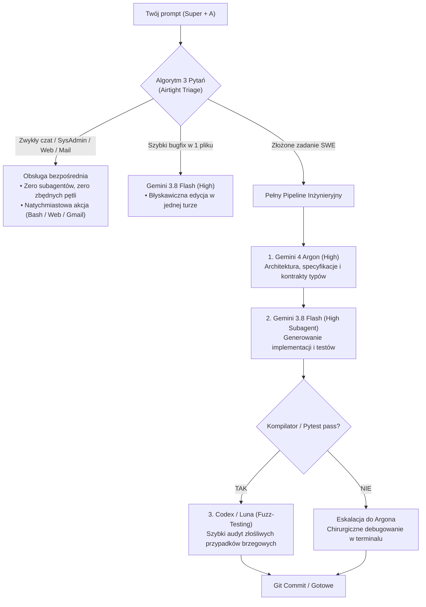

# 🌌 Omarchy AI Multi-Agent Orchestration

> **A compute-optimal, multi-model AI coding and system intelligence environment built natively for Omarchy & Hyprland.**

This repository contains the complete configuration, custom collectors, window rules, keybindings, and triage guidelines to turn **Google Antigravity** (`agy`) and **OpenAI Codex** into a unified, zero-friction pair programming system operable entirely from a single interface.

---

## ⚡ Architektura Systemu (Compute-Optimal Multi-Agent)

Zamiast ręcznego skakania między modelami lub przepalania limitów na prostych zadaniach, system opiera się na **Trzech Warstwach Obliczeniowych**:



1. **Daily Driver (Domyślny Model): Gemini 3.8 Flash (High)**
   - Błyskawiczny czas reakcji (>100 tps).
   - Wykorzystuje ogromny, odnawialny 5-godzinny i tygodniowy limit Gemini (>90% zapasu).
   - Odpowiada za 95% codziennych zadań (administracja systemem, maile, skrypty, edycja kodu).
2. **Heavy Artillery (Architekt & Chirurg): Gemini 4 Argon (High)**
   - 1M tokenów unifikowanego wyjścia, bezkonkurencyjne DeepSWE (77.9%) i Terminal-Bench (57.4%).
   - Uruchamiany automatycznie jako subagent (`Model: 'pro'`) lub ręcznie (`/model`) do zadań architektonicznych i trudnych błędów.
   - Chroni swój dedykowany tygodniowy limit przed przypadkowym wyczerpaniem.
3. **Fuzz-Tester & Ghost Reviewer: OpenAI Codex (GPT-6 Luna)**
   - Odpytywany asynchronicznie w tle przez `~/.local/bin/codex-query`.
   - Generuje przypadki brzegowe, testuje nietypowe dane i weryfikuje schematy JSON.
   - Posiada wbudowany **Auto-Fallback** na Gemini Flash w razie przekroczenia limitu API.

---

## 🧭 Matryca 16 Profili Operacyjnych

Wszystkie zapytania są klasyfikowane w locie bez ingerencji użytkownika:

| # | Profil | Przykładowy Prompt | Działanie w Tle |
| :-: | :--- | :--- | :--- |
| **1** | **Czysty Czat & Myślenie** | *„Wytłumacz twierdzenie CAP”* | Czysta odpowiedź w 1 turze. Zero narzędzi. |
| **2** | **Redagowanie & Treści** | *„Popraw styl tego README.md”* | Bezpośrednia edycja tekstu. Brak kompilatorów. |
| **3** | **SysAdmin & Omarchy** | *„Czemu bluetooth rwie połączenie?”* | Bezpieczne komendy bash (`wpctl`, `hyprctl`, `omarchy`). |
| **4** | **Biały Wywiad & Research** | *„Sprawdź breaking changes w v2.0 biblioteki X”* | Wyszukiwarka internetowa (`search_web`) + synteza źródeł. |
| **5** | **Analiza Danych & CSV** | *„Przeanalizuj sales.csv i wyciągnij średnie”* | Skrypt w Pythonie lub `sqlite3` uruchomiony w tle. |
| **6** | **Multimodalność & OCR** | *„Czemu na tym screenie UI tekst nachodzi na button?”* | Wbudowane widzenie komputerowe Gemini (analiza układu/OCR). |
| **7** | **Skrypty Ad-Hoc** | *„Daj jednolinijkowiec ffmpeg do kompresji wideo”* | Gotowy kod prosto w oknie czatu bez pętli deweloperskiej. |
| **8** | **DevOps & CI/CD** | *„Napisz wieloetapowy Dockerfile pod Rusta”* | Walidacja syntaktyczna plików YAML / Docker. |
| **9** | **Szybki Kod (Single-File)** | *„Zmień kolor przycisku w Button.tsx”* | Bezpośrednia edycja przez Flasha bez planowania. |
| **10** | **Pełna Inżynieria (Heavy SWE)**| *„Zaimplementuj webhooki Stripe z testami i walidacją”*| Pełny potok: Argon (plan) ➔ Flash (kod) ➔ Testy ➔ Codex. |
| **11** | **Asystent & WebApps** | *„Napisz za mnie maila w Gmailu do szefa”* | Treść do schowka (`wl-copy`) + link compose w przeglądarce. |
| **12** | **Multimedia & Wideo** | *„Wytnij pierwsze 30 sekund z nagrania.mp4”* | Narzędziowe wywołanie `ffmpeg` / `yt-dlp` / `magick`. |
| **13** | **Sprzęt & Peryferia** | *„Sprawdź temperaturę GPU i stan baterii”* | Diagnostyka peryferiów (`nvidia-smi`, `upower`, `hyprctl`). |
| **14** | **Bezpieczeństwo & Klucze** | *„Wygeneruj parę kluczy SSH Ed25519”* | Audyt sekretów. Blokada ujawniania tokenów w logach. |
| **15** | **Higiena Gita** | *„Rozwiąż ten konflikt rebase na gałęzi dev”* | Operacje `git` z twardym sprawdzeniem diffa. |
| **16** | **Matematyka & Algorytmy** | *„Zoptymalizuj złożoność tego algorytmu z O(n²) do O(n log n)”* | Analityczny wywód lub symulacja numeryczna. |

---

## 🖥️ Integracja z Pulpitem Omarchy (Hyprland + Waybar)

- **Skrót Klawiszowy (<kbd>Super</kbd> + <kbd>A</kbd>)**:
  Błyskawiczne wywołanie okna agenta z dowolnego miejsca w systemie (zastępuje niewygodny 4-klawiszowy skrót).
- **Pływające Okno HUD (`1100×750`)**:
  Okno agenta (`org.omarchy.agent`) nie rozpycha kafelków Hyprlanda — pojawia się wycentrowane jako elegancki floating HUD.
- **Ikona i Panel na Pasku Omarchy**:
  - **Na żywo**: Autorytatywne limity 5-godzinne i tygodniowe pobierane bezpośrednio z silnika Google (`agy -p "/usage"`).
  - **Wykres tygodniowy**: Rzeczywista suma milionów tokenów dziennie (zamiast liczby promptów).
  - **Rozbicie modeli**: Statystyki tokenów wejścia, wyjścia i cache dla każdego modelu, którego używałeś.
  - **Przełącznik subskrypcji**: Środkowy przycisk myszy lub klawisze <kbd>h</kbd> / <kbd>l</kbd> przełączają w locie podgląd między **Antigravity** a **Codexem**.

---

## 🚀 Instalacja na Nowej Maszynie (One-Click)

Jeśli zmienisz maszynę lub przeinstalujesz system:

```bash
# 1. Sklonuj repozytorium
git clone https://github.com/nicolesiecky/omarchy-ai-orchestration.git
cd omarchy-ai-orchestration

# 2. Uruchom automatyczny instalator
./install.sh
```

Instalator automatycznie:
1. Skopiuje i nada uprawnienia skryptom w `~/.local/bin/`.
2. Skonfiguruje domyślnego agenta w Omarchy i doda pozycję do menu.
3. Włączy podwójny monitoring agentów (`antigravity` + `codex`) na pasku.
4. Zainstaluje globalne reguły `AGENTS.md` oraz skill dla Codexa.
5. Skonfiguruje serwery MCP (m.in. oficjalny serwer Figma MCP).
6. Dopisze skrót <kbd>Super</kbd> + <kbd>A</kbd> i regułę okna do Hyprlanda.
7. Zrestartuje pasek Omarchy i zrekompiluje konfigurację Hyprlanda.

---

## 🔌 Integracja MCP (Model Context Protocol) & Narzędzia

W repozytorium znajduje się wstępnie skonfigurowana integracja z protokołem **MCP** (`~/.gemini/config/mcp_config.json`):

- **Figma MCP (`https://mcp.figma.com/mcp`)**: Umożliwia agentowi bezpośredni odczyt plików, komponentów, hierarchii węzłów i tokenów stylów z Figmy.

Narzędzie można weryfikować bezpośrednio przez CLI Antigravity:
```bash
agy mcp list
```

---

## 🏛️ Architektura Rozszerzona (Claude Fable 5.1 Roadmap)

Kompletna koncepcja włączenia modelu **Claude Fable 5.1** do ekosystemu (jako Lead Architect, audytor design systemów i arbiter jakości) została szczegółowo udokumentowana w:
👉 **[`docs/claude-fable-architecture.md`](docs/claude-fable-architecture.md)**

---

## 📁 Struktura Plików

```text
omarchy-ai-orchestration/
├── install.sh                                # Skrypt instalacyjny (idempotentny)
├── README.md                                 # Kompletna dokumentacja
├── docs/
│   └── claude-fable-architecture.md          # Koncepcja 4-modelowa z Claude Fable 5.1
├── bin/
│   ├── omarchy                               # Wrapper CLI przekierowujący komendy agenta
│   ├── omarchy-agent                         # Launcher agenta TUI w oknie org.omarchy.agent
│   ├── omarchy-default-agent                 # Zarządzanie domyślnym agentem (obsługa antigravity)
│   ├── omarchy-agent-usage-antigravity       # Natywny kolektor statystyk i limitów na żywo
│   ├── omarchy-agent-usage-update            # Runner zbierający dane do ~/.local/state/omarchy/
│   └── codex-query                           # Asynchroniczny most do Codexa z auto-fallbackiem
└── config/
    ├── gemini/
    │   ├── AGENTS.md                         # 16 Profili i Algorytm 3 Pytań
    │   └── mcp_config.json                   # Konfiguracja serwerów MCP (Figma)
    ├── omarchy/
    │   ├── defaults/agent                    # Domyślny agent (antigravity)
    │   └── extensions/omarchy-menu.jsonc     # Wpis w menu Omarchy (Setup > Agent)
    ├── hypr/
    │   ├── bindings.patch.lua                # Skrót klawiszowy Super+A
    │   └── hyprland.patch.lua                # Reguła pływającego okna 1100x750
    └── skills/
        └── codex-query/SKILL.md              # Skill Antigravity do zapytań do Codexa
```

---

## 📄 Licencja

MIT © [Nico Lesiecky](https://github.com/nicolesiecky)
