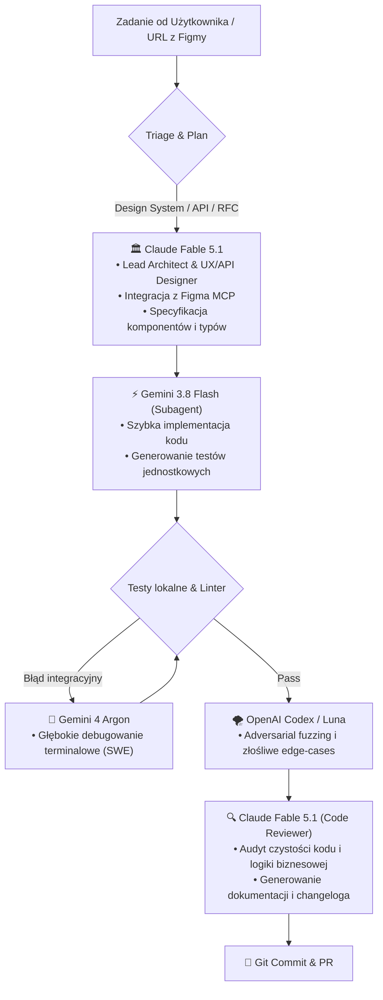

# 🏛️ Architektura Rozszerzona: Rola Claude Fable 5.1 w Ekosystemie Omarchy

> **Koncepcja strategiczna integracji modelu Claude Fable 5.1 z Antigravity, Argonem, Flashem i Codexem.**

Ten dokument utrwala projekt architektury wielomodelowej z uwzględnieniem modelu **Claude Fable 5.1** jako czwartego filaru ekosystemu operacyjnego Omarchy.

---

## 🎯 Główne Przeznaczenie i Specjalizacja (Sweet Spot)

Modele z rodziny Claude (w tym Fable 5.1) wyróżniają się bezkonkurencyjną elegancją w projektowaniu API, wyczuciem UI/UX, dbałością o detale oraz zrównoważonym, krytycznym okiem podczas przeglądu kodu.

W naszym układzie **nie używamy Claude do codziennych prostych zapytań** (gdzie Gemini Flash jest bezkonkurencyjnie szybki i tani) ani do surowej chirurgii terminalowej (gdzie Gemini Argon dominuje w testach SWE-bench). Claude Fable 5.1 pełni funkcję **Senior Tech Leada i Arbitra Jakości**.

---

## 🧩 4 Kluczowe Role Claude Fable 5.1

### 1. Architekt API i Strażnik Developer Experience (DX)
- **Zadanie:** Przed napisaniem właściwego kodu w złożonych modułach, Fable 5.1 definiuje czyste, ergonomiczne kontrakty TypeScript / Rust / Python.
- **Dlaczego Claude:** Posiada wyjątkową zdolność unikania przekombinowanych abstrakcji, tworząc API, które jest intuicyjne dla człowieka.

### 2. Most UI/UX & Integracja z Figma MCP
- **Zadanie:** Połączenie z oficjalnym serwerem Figma MCP (`https://mcp.figma.com/mcp`).
- **Przebieg:**
  1. Pobranie z Figmy struktury węzłów (frames, auto-layout, tokeny kolorów i typografii).
  2. Przetłumaczenie przez Claude Fable hierarchii wizualnej na semantyczny kod komponentów (React / Tailwind / Vue).
  3. Claude dba o dostępność (a11y), stany hover/focus/disabled i responsywność, eliminując typowe „halucynacje stylowe”.

### 3. Senior Code Reviewer & Audytor Logiki Biznesowej
- **Zadanie:** Ostateczny przegląd diffa przed zatwierdzeniem zmian w repozytorium.
- **Na co zwraca uwagę:**
  - Ukryte wyścigi danych (race conditions) w asynchronicznym kodzie.
  - Czytelność kodu dla innych programistów.
  - Zgodność z konwencjami repozytorium i bezpieczeństwo danych.

### 4. Główny Redaktor Dokumentacji i Komunikacji
- **Zadanie:** Pisanie RFC, Architecture Decision Records (ADR), changelogów oraz zewnętrznej dokumentacji technicznej.
- **Efekt:** Dokumentacja techniczna brzmi profesjonalnie, naturalnie i bez sztucznego żargonu generowanego przez pośpieszne modele.

---

## 📊 Matryca Współpracy Modeli

| Model | Rola w Systemie | Kiedy Uruchamiać | Typ Wywołania |
| :--- | :--- | :--- | :--- |
| **Gemini 3.8 Flash** | **Daily Driver & Fast SWE** | 95% zadań, admin Linuxa, edycja plików, szybkie skrypty | Bezpośredni w TUI / `Super+A` |
| **Gemini 4 Argon** | **Heavy SWE Surgeon** | Trudne błędy kompilacji, złożone refaktoryzacje, 1M tokenów | Subagent (`Model: 'pro'`) / `/model` |
| **Claude Fable 5.1** | **Tech Lead & Figma/UX Arbiter** | Architektura, integracja Figma MCP, code review, dokumentacja | Subagent dedykowany / Sidecar API |
| **OpenAI Codex** | **Fuzz-Tester & Edge Case Hunter**| Wyszukiwanie dziur logicznych, fuzzing JSON, testy brzegowe | Skrypt w tle `~/.local/bin/codex-query` |

---

## 🔌 Gotowość Techniczna (Jak Aktywować)
Gdy dostęp do Claude Fable 5.1 zostanie uruchomiony w środowisku:
1. Skonfiguruj klucz API w `~/.config/omarchy/claude.env` lub sidecarze MCP.
2. Zarejestruj subagenta `claude-architect` w definicjach Antigravity (`define_subagent`).
3. Wykorzystaj zintegrowane MCP Figmy (`agy mcp list`), aby Claude mógł natywnie czytać makiety i tokeny projektowe.
